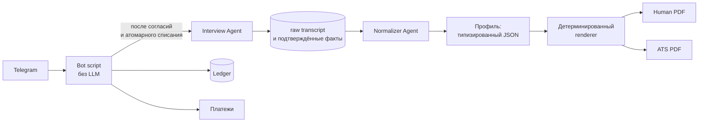

# ResumeMaker

[](https://github.com/AkaDaka1/ResumeMaker/actions/workflows/ci.yml)
[](LICENSE)
[](https://www.python.org/downloads/)
[](https://github.com/astral-sh/ruff)

Telegram-бот, который проводит интервью с кандидатом и выпускает два PDF: визуально аккуратный
**Human PDF** для HR и линейный **ATS PDF** для систем подбора.

Исходные ответы кандидата — источник истины. Нормализованный профиль и PDF являются производными
данными: их можно пересобрать, не теряя и не переписывая исходные ответы.

> **English summary.** ResumeMaker is a Telegram bot that interviews a candidate in Russian or
> English and produces two PDFs from the same profile: a designed one for recruiters and a
> linear, parser-friendly one for applicant tracking systems. The repository currently contains
> the Sprint 1 foundation: typed domain model, explicit state machines, PostgreSQL schema, an
> idempotent credit ledger, and fake payment/LLM providers. Telegram, the interview pipeline,
> and PDF rendering are intentionally not implemented yet.

## Статус

Проект находится в ранней разработке (Sprint 1 завершён, версия `0.1.0`). Реальные платежи,
ключи LLM и production-интеграция Telegram намеренно не подключены.

| Компонент | Состояние |
| --- | --- |
| Доменные типы, ошибки, автоматы состояний, цены | ✅ |
| PostgreSQL-схема и Alembic-миграции | ✅ |
| Ledger: неизменяемый журнал, идемпотентность, запрет овердрафта | ✅ |
| Атомарный старт платной операции (`debit + operation + job`) | ✅ |
| Платёжный сервис и fake-провайдер с HMAC-подписью | ✅ |
| LLM-адаптер: контракт, fake-провайдер, классификация ошибок AnyModel | ✅ |
| Согласия на обработку данных и передачу внешнему LLM | ✅ |
| FastAPI: `/healthz`, `/readyz`, локальный fake-webhook | ✅ |
| Telegram bot script | ⏳ |
| Interview / Normalizer / Renderer, профиль и PDF | ⏳ |

Подробности и границы: [`docs/sprint-1-plan.md`](docs/sprint-1-plan.md).

## Архитектура

Целевой pipeline:



Ключевые инварианты, которые уже защищены кодом и тестами:

- **Ledger — журнал, а не изменяемое поле баланса.** Баланс = сумма подтверждённых записей;
  каждая запись идемпотентна по ключу `debit:<operation>`, `refund:<operation>`,
  `purchase:<payment>` и т. п.
- **Нет списания без операции.** Дебет, операция и запуск job создаются в одной транзакции;
  повторный вызов не списывает деньги дважды.
- **Нет отрицательного баланса.** Конкурентные списания сериализуются блокировкой пользователя.
- **Ошибка до результата возвращает кредит ровно один раз.**
- **Webhook проверяется на сервере.** Подпись, сумма, валюта и назначение сверяются до начисления;
  повторное событие не начисляет кредиты повторно.
- **Согласия раздельные.** Обработка/хранение данных и передача текста внешнему LLM фиксируются
  отдельно, с версией и hash текста.
- **Fake-провайдеры не работают вне local/test.** `staging` и `production` отклоняются при старте,
  пока реальные интеграции не реализованы.
- **Внутренние кредиты ≠ balance tokens провайдера.** Это две разные единицы, они не смешиваются.

## Требования

- Python **3.11+** (проект проверен на 3.15);
- PostgreSQL **14+**;
- Windows PowerShell для `scripts/test.ps1`; на Linux/macOS тесты запускаются напрямую через
  `pytest` (см. ниже).

## Быстрый старт

### Windows (PowerShell)

```powershell
python -m venv .venv
.\.venv\Scripts\python.exe -m pip install -e ".[dev]"
Copy-Item .env.example .env

# Создайте базу и пользователя, если их ещё нет:
#   createuser --createdb resumemaker
#   createdb -O resumemaker resumemaker

.\.venv\Scripts\python.exe -m alembic upgrade head
.\.venv\Scripts\python.exe -m uvicorn resumemaker.api.app:create_app --factory --reload
```

### Linux / macOS

```bash
python3 -m venv .venv
source .venv/bin/activate
pip install -e ".[dev]"
cp .env.example .env

createdb resumemaker  # при необходимости создайте роль заранее
alembic upgrade head
uvicorn resumemaker.api.app:create_app --factory --reload
```

После старта:

- `http://127.0.0.1:8000/healthz` — процесс жив;
- `http://127.0.0.1:8000/readyz` — база доступна;
- `http://127.0.0.1:8000/docs` — OpenAPI, только в local/test.

## Конфигурация

Настройки читаются из переменных окружения с префиксом `RESUMEMAKER_` и из `.env`.
Шаблон — [`.env.example`](.env.example); реальные секреты в репозиторий не попадают.

| Переменная | По умолчанию | Назначение |
| --- | --- | --- |
| `RESUMEMAKER_ENV` | `local` | `local` или `test`; `staging`/`production` пока отклоняются |
| `RESUMEMAKER_DATABASE_URL` | локальный PostgreSQL | SQLAlchemy URL с драйвером `psycopg` |
| `RESUMEMAKER_FAKE_PAYMENT_SECRET` | локальная заглушка | HMAC-секрет fake-провайдера, только local/test |
| `RESUMEMAKER_ENABLE_FAKE_WEBHOOK_ENDPOINT` | `false` | Включает `POST /payments/fake/webhook` в local/test |
| `RESUMEMAKER_INITIAL_GRANT_CREDITS` | `100` | Стартовый баланс; должен покрывать одну preview-генерацию |

## Тесты

Тесты идут против **настоящего PostgreSQL**: корректность ledger держится на реальных блокировках
строк и уникальных ограничениях, SQLite проверил бы не то поведение.

На Windows скрипт поднимает одноразовый trust-auth кластер в `%TEMP%\resumemaker-pgtest`
на порту `55432` и не трогает системный PostgreSQL:

```powershell
.\scripts\test.ps1            # весь набор
.\scripts\test.ps1 tests/test_ledger.py -v
.\scripts\test.ps1 -Stop      # остановить тестовый кластер
```

На Linux/macOS (или если PostgreSQL уже есть) задайте базу, в которой у пользователя есть право
`CREATEDB` — каждый прогон создаёт и удаляет временные базы:

```bash
export RESUMEMAKER_TEST_DATABASE_URL="postgresql+psycopg://postgres@127.0.0.1:5432/postgres"
python -m pytest
```

Линтер:

```bash
python -m ruff check .
```

## Структура

```text
src/resumemaker/
  api/          FastAPI-приложение: health/readiness, локальный fake-webhook
  db/           SQLAlchemy-модели, движок и unit of work
  domain/       enum'ы, ошибки, автоматы состояний, цены и конвертация usage
  providers/    контракты и fake-реализации платёжного и LLM-провайдеров
  services/     ledger, операции, платежи, job, согласия, usage
migrations/     Alembic; начальная схема 0001
tests/          pytest против реального PostgreSQL
scripts/        вспомогательные скрипты (тестовый кластер)
docs/           продуктовые решения и план спринта
agents/         правила доменных агентов (интервью, нормализация, рендеринг, дизайн)
```

## Документация

- [`AGENTS.md`](AGENTS.md) — архитектурные правила и границы компонентов;
- [`docs/product-decisions.md`](docs/product-decisions.md) — зафиксированные продуктовые решения MVP;
- [`docs/sprint-1-plan.md`](docs/sprint-1-plan.md) — объём Sprint 1, инварианты и границы;
- [`agents/`](agents/) — правила Interview, Normalizer, Resume Renderer и PDF Designer;
- [`CHANGELOG.md`](CHANGELOG.md) — история изменений.

## Что дальше

1. Telegram bot script: команды, согласия, баланс и статусы без LLM-вызовов.
2. Схема профиля кандидата и сценарии вакансий (backend/frontend + generic fallback).
3. Interview → Normalizer pipeline с fake-LLM и golden-тестами.
4. Детерминированный renderer и два PDF-шаблона.
5. Реальный платёжный адаптер (Telegram Stars, СБП) через transactional outbox.
6. Реальная интеграция AnyModel после capability-тестов на structured output.

## Участие и безопасность

Правила участия: [`CONTRIBUTING.md`](CONTRIBUTING.md), кодекс поведения:
[`CODE_OF_CONDUCT.md`](CODE_OF_CONDUCT.md). Об уязвимостях сообщайте приватно по
[`SECURITY.md`](SECURITY.md), а не публичным issue. Пожалуйста, не используйте реальные
персональные данные в fixtures, тестах и скриншотах.

## Лицензия

[MIT](LICENSE) © 2026 Danil M.
